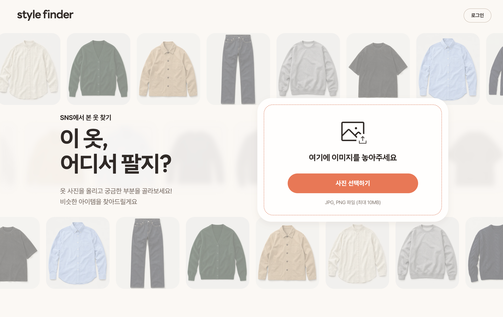
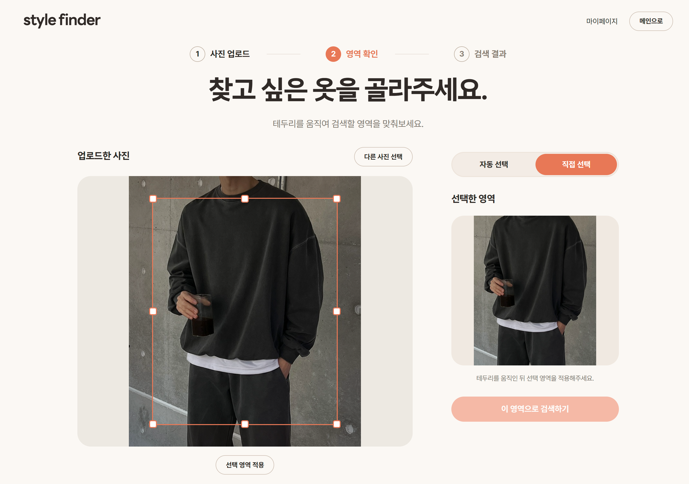
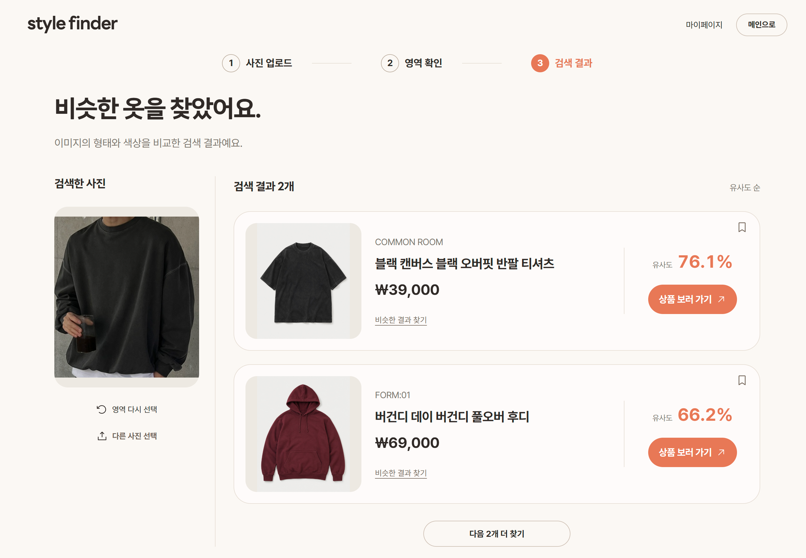
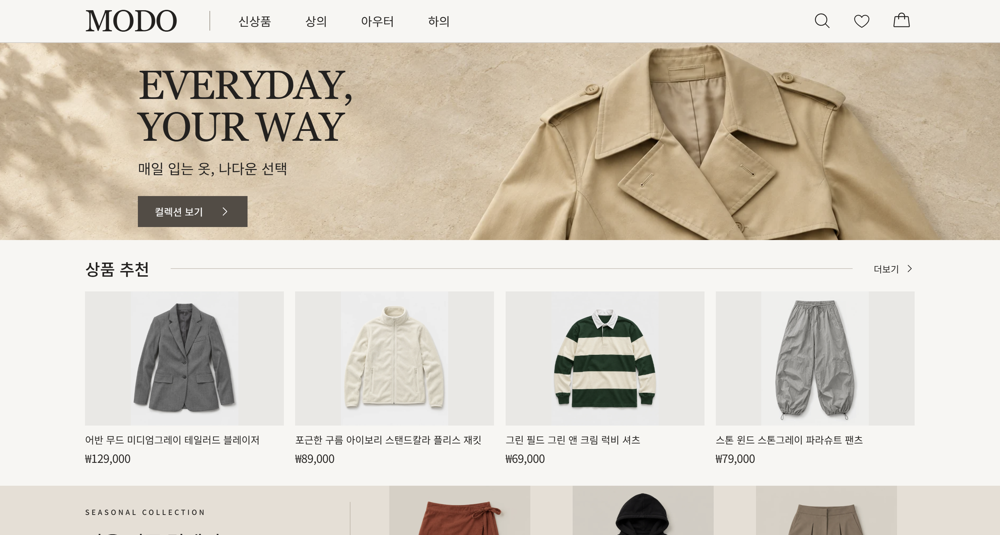
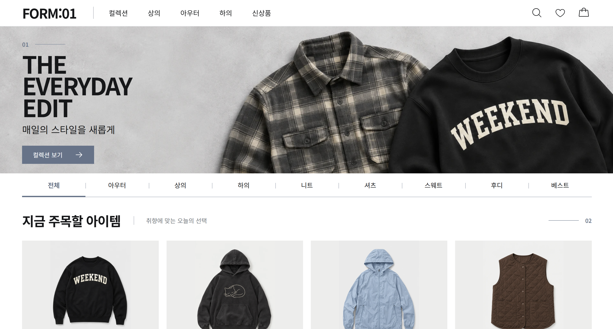
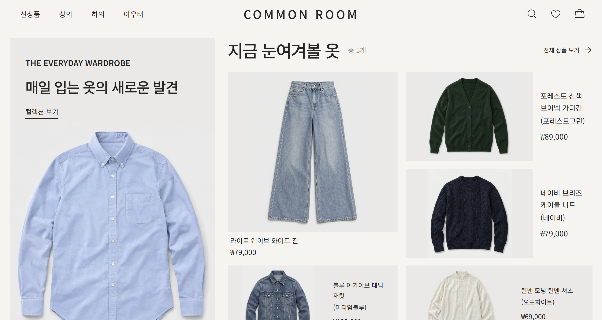

# Style Finder

사진에서 선택한 옷과 비슷한 카탈로그 이미지를 찾는 패션 이미지 유사도 검색
포트폴리오입니다. OpenCV 기반 관심 영역 전처리, FashionCLIP 임베딩, NumPy 기반
벡터 검색에 Spring Boot 회원 서비스와 MySQL을 결합하고 있습니다.

현재 React, FastAPI, Spring Boot, MySQL, Caddy가 하나의 Docker Compose
스택으로 실행됩니다. 서비스 경계, 서버 측 인증, 사용자별 활동 기능은 구현되어 있습니다.

## 서비스 소개

SNS에서 본 사진 속 옷이 궁금할 때, 사진을 올리고 찾고 싶은 옷의 영역을 선택하면
비슷한 상품을 찾아주는 서비스입니다. 검색 결과에서 상품 이미지와 가격, 판매처를
확인하고 가상 쇼핑몰의 해당 상품 상세 페이지로 이동할 수 있습니다.

[Style Finder 열기](https://fashion.cora1022.com/)

### 메인화면



### 영역 선택과 검색 결과

사진에서 검색할 영역을 자동으로 제안받거나 직접 조절할 수 있습니다. 선택한 영역을
기준으로 유사한 상품을 찾고, 결과를 저장하거나 비슷한 상품을 다시 검색할 수 있습니다.

| 옷 영역 선택 | 유사 상품 검색 결과 |
|---|---|
|  |  |

## 가상 쇼핑몰

처음에는 네이버 쇼핑 API에서 상품 정보를 가져왔습니다. 외부 상품 이미지의 저작권과
재배포 문제, API 의존성을 고려해 생성형 의류 이미지로 포트폴리오용 쇼핑몰 세 곳을
직접 만들고 검색 서비스에 연결했습니다.

각 쇼핑몰은 서로 다른 디자인의 정적 웹으로, 상품마다 고유한 상세 페이지가 있습니다.
총 80개 상품을 검색 카탈로그에 등록했으며, 검색 결과의 `상품 보러 가기`를 누르면
해당 상품 페이지로 이동합니다.

| [MODO](https://shop1.cora1022.com/) | [FORM:01](https://shop2.cora1022.com/) | [COMMON ROOM](https://shop3.cora1022.com/) |
|---|---|---|
| [](https://shop1.cora1022.com/) | [](https://shop2.cora1022.com/) | [](https://shop3.cora1022.com/) |

## 현재 구현

### 사용자 화면

- SNS 사진으로 옷을 찾는 랜딩, 로그인, 회원가입 화면
- 로그인 후 이미지 업로드, 자동 및 수동 크롭, 유사 이미지 검색
- JPEG/PNG 사전 검증: 최대 10MiB, 최대 1,600만 픽셀
- 카탈로그 ID 기반 재검색과 유사도 결과 표시
- 새로고침 세션 복원과 Access Token 자동 갱신
- 검색 기록, 결과 저장, 삭제, 저장 이미지 재검색, 마이페이지

### 이미지 검색 서비스

- FastAPI 업로드 검증과 안전한 오류 응답
- OpenCV HOG 기반 사람 상반신 추정과 YOLO 모델을 이용한 의류 영역 제안
- FashionCLIP 512차원 임베딩과 NumPy 로컬 코사인 유사도 검색
- 임의 URL 다운로드 API 제거와 로컬 manifest 기반 이미지 제공
- 추론 thread offload, 동시 실행 제한, liveness/readiness
- 대기열 timeout과 실제 실행 timeout 분리
- 권리 메타데이터 기반 카탈로그 인덱서와 가상 쇼핑몰 이미지 가져오기
- Spring Boot가 발급한 RS256 Access Token을 이용한 검색과 크롭 API 보호

### 회원 서비스

- Spring Boot 3, Java 21, Spring Security
- 회원가입, 로그인, 내 정보 조회
- Google OpenID Connect 로그인과 기존 세션 연동
- BCrypt 비밀번호 해시
- Access/Refresh Token 발급과 Refresh Token 해시 저장, 회전, 폐기
- RSA 비대칭키 서명, issuer, audience, 만료, token type 검증
- 일관된 Spring Security 401/403 오류 응답
- HttpOnly Refresh 쿠키, 회전, 폐기, 로그아웃, 만료 데이터 정리
- MySQL과 Flyway V1/V2/V3/V4 migration
- 페이지네이션과 소유권 조건을 적용한 검색 기록 및 저장 결과 API
- JSON metadata 직렬화와 사용자별 접근 차단
- H2 통합 테스트와 MySQL Testcontainers migration 테스트
- MySQL과 Flyway 기반 readiness

React는 검색과 크롭 요청에 Access Token을 전달하고, FastAPI는 Spring Boot와 공개키를
공유해 서명과 표준 claim을 검증합니다. Refresh Token 원문은 JSON에 포함하지 않고
HttpOnly 쿠키로만 전달합니다. 자세한 흐름은 [인증 문서](docs/AUTHENTICATION.md)를
참고하세요.

## 아키텍처

```text
Browser
  → Caddy
    → /                         React와 Nginx
    → /api/members/*            Spring Boot → MySQL
    → /api/search/*             FastAPI → 로컬 벡터 인덱스
    → /api/preprocess/*         FastAPI
    → /api/catalog/*            FastAPI
```

Spring Boot와 FastAPI는 데이터베이스를 공유하지 않습니다. Spring Boot는 회원과 사용자
활동 데이터를, FastAPI는 이미지 처리와 벡터 검색을 소유합니다. 자세한 내용은
[아키텍처 문서](docs/ARCHITECTURE.md)를 참고하세요.

## 로컬 실행

JDK 21, Docker Desktop이 필요합니다. `.env.example`의 비밀번호는 로컬 실행 기본값일
뿐 운영 환경에서 사용하면 안 됩니다. RSA 키는 첫 Compose 실행 시 전용 Docker volume에
생성되며 Git에 저장되지 않습니다.

```powershell
docker compose --env-file .env.example config
docker compose --env-file .env.example up -d --build
docker compose --env-file .env.example ps
```

접속 주소는 `http://localhost`입니다.

검색을 사용하려면 로컬 카탈로그와 이미지가 필요합니다. 카탈로그 준비 방법은
[catalog/README.md](catalog/README.md)를 참고하세요.

## 검증

```powershell
uv sync --frozen
uv run ruff check backend
uv run pytest backend/tests -q

cd frontend
npm ci
npm run test
npm run lint
npm run build

cd ../member-service
./gradlew check
./gradlew bootJar
```

현재 FastAPI 테스트 29개, React 테스트 33개, Spring Boot H2와 단위 테스트 25개가
실행됩니다. Docker 사용 가능 환경에서는 MySQL 8.4 Testcontainers migration 테스트
1개가 추가로 실행됩니다.

별도 서비스 연동 테스트는 실제 Spring Boot와 MySQL을 실행해 FastAPI 인증, 검색 결과 저장과 사용자 데이터 격리를 검증합니다. 실행 방법과 테스트 대역의 범위는 [테스트 문서](docs/TESTING.md)를 참고하세요.
